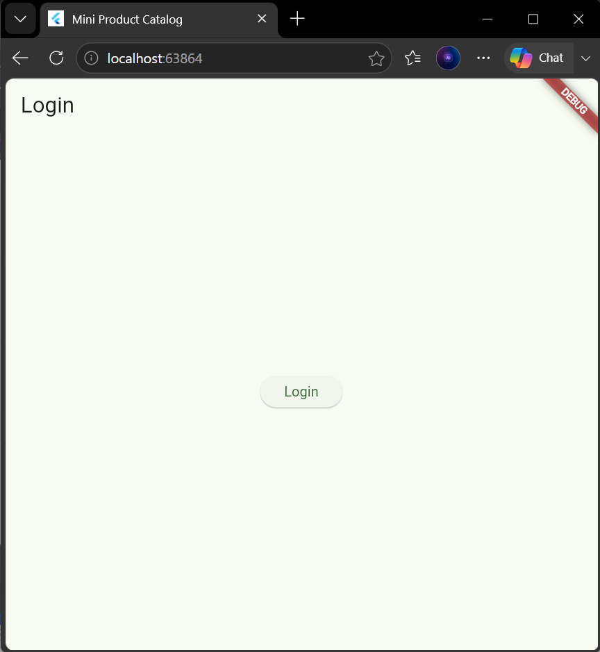
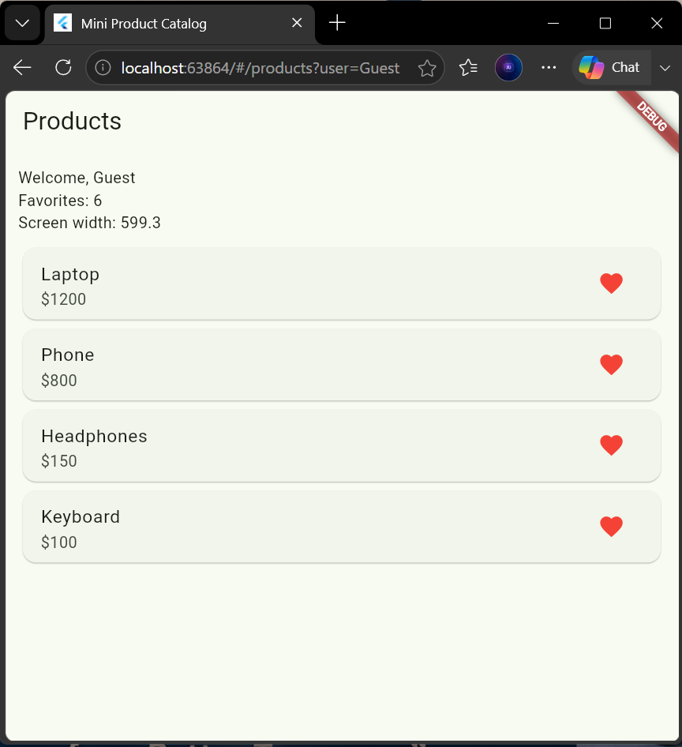
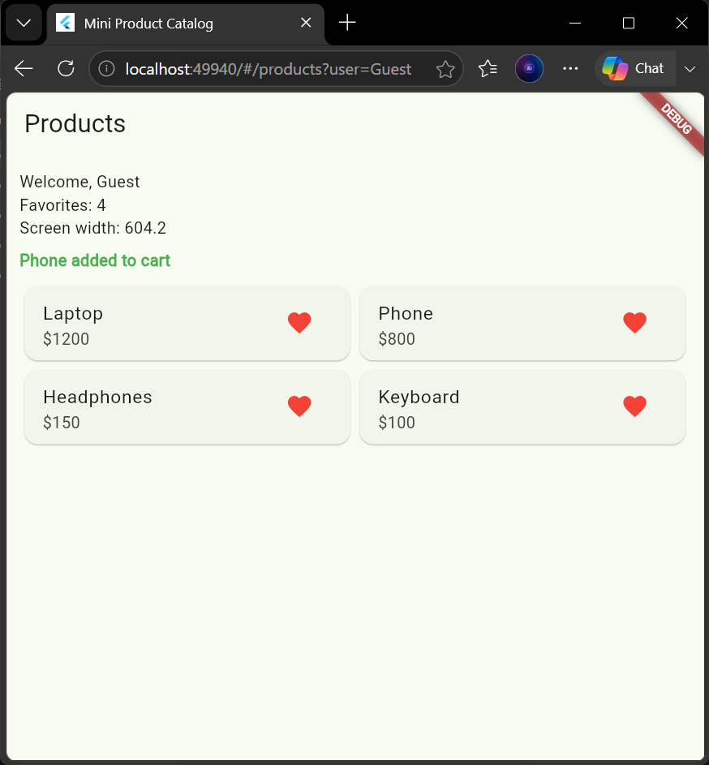
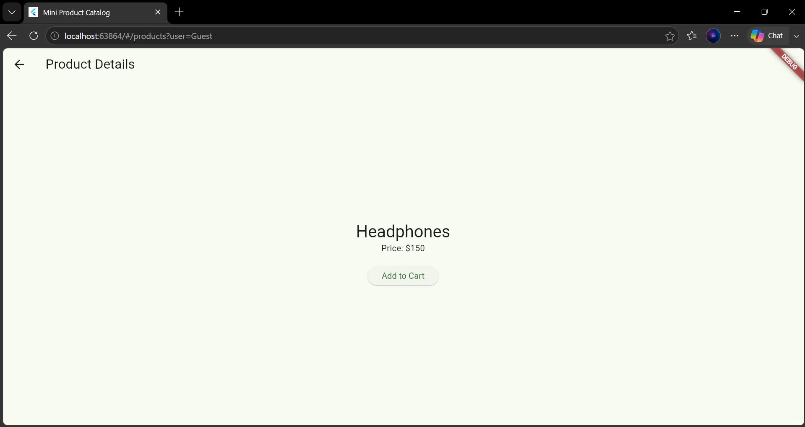
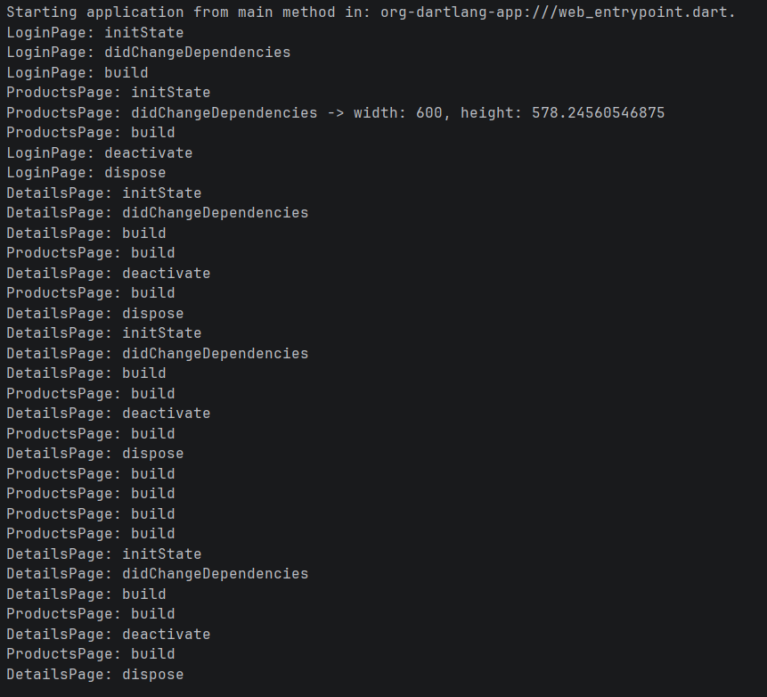
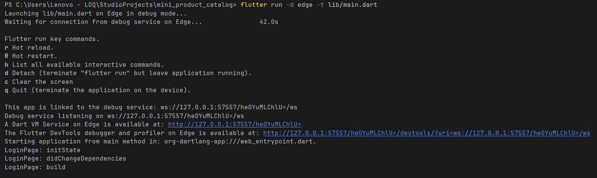

# 🛍️ Mini Product Catalog

A responsive Flutter application developed as a Mobile Development course assignment. This project demonstrates navigation, responsive UI design, state management, route parameters, and Flutter widget lifecycle methods.

## 📱 Screenshots

### Login Screen


### Products — List View


### Products — Grid View


### Product Details


### Debug Console — Lifecycle Logs




## ✨ Features

- **Login Screen:** Navigate to the products page using the username `Guest`.
- **Product Catalog:** Browse the available products and open their details.
- **Product Details:** Display the selected product's name and price.
- **Responsive Layout:** Automatically switches between list and grid layouts according to screen width.
- **Favorites Counter:** Add products to favorites and update the counter using `setState()`.
- **GoRouter Navigation:** Navigate between screens using named routes, query parameters, and path parameters.
- **Navigation Results:** Return an Add to Cart message from the details page to the products page.
- **Widget Lifecycle Logging:** Display lifecycle events in the debug console.

## 🧰 Technologies Used

- Flutter
- Dart
- GoRouter
- Material Design
- Git and GitHub

## 🗂️ Project Structure

```text
mini_product_catalog/
├── lib/
│   ├── main.dart
│   ├── main_navigator.dart
│   └── product_widgets.dart
├── Screenshots/
├── android/
├── ios/
├── linux/
├── macos/
├── web/
├── windows/
├── pubspec.yaml
└── README.md
```

## 🧭 Navigation

### GoRouter — Active Implementation

The active application uses GoRouter with these routes:

| Route | Description |
|---|---|
| `/` | Login screen |
| `/products?user=Guest` | Products screen with a query parameter |
| `/details/:name/:price` | Product details using path parameters |

The application demonstrates:

- `context.goNamed()` for navigating from Login to Products.
- `context.push()` for opening Product Details and awaiting a result.
- `context.pop()` for returning the Add to Cart message to the previous screen.

### Navigator — Alternative Implementation

The traditional Navigator version is available in `lib/main_navigator.dart` for comparison.

It demonstrates named routes, passing arguments between screens, and returning results with `Navigator.pop()`.

## 🔄 Widget Lifecycle

The screens demonstrate the following Flutter lifecycle methods:

- `initState()`
- `didChangeDependencies()`
- `build()`
- `deactivate()`
- `dispose()`

Lifecycle messages are printed in the debug console. The application also reads screen dimensions using `MediaQuery` inside `didChangeDependencies()`.

## 📐 Responsive Design

The application adapts its layout to the available screen width:

- **Width below 600 pixels:** List layout.
- **Width of 600 pixels or more:** Grid layout.

Resize the browser window to observe the layout change and the corresponding debug console output.

## ⚙️ Getting Started

### Prerequisites

- Flutter SDK
- Dart SDK
- Visual Studio Code or Android Studio

### Installation

1. Clone the repository:

   ```bash
   git clone https://github.com/JohnGerges20/mini_product_catalog.git
   ```

2. Navigate to the project directory:

   ```bash
   cd mini_product_catalog
   ```

3. Install dependencies:

   ```bash
   flutter pub get
   ```

4. Run the application:

   ```bash
   flutter run
   ```

To run the application in Microsoft Edge:

```bash
flutter run -d edge -t lib/main.dart
```

## 🎯 Learning Objectives

This project provides practical experience with:

- Flutter navigation using GoRouter and Navigator.
- Passing data through route parameters.
- Returning results between screens.
- Managing UI state with `setState()`.
- Building responsive interfaces with `MediaQuery`.
- Understanding and observing widget lifecycle methods.

---

# 👨‍💻 Author

**John Gerges**

📧 Email: [johngwanes@gmail.com](mailto:johngwanes@gmail.com)

🔗 LinkedIn: [https://www.linkedin.com/in/john-gerges-a59592336/](https://www.linkedin.com/in/john-gerges-a59592336/)

## 📚 Course Assignment

Flutter Mobile Development Assignment
